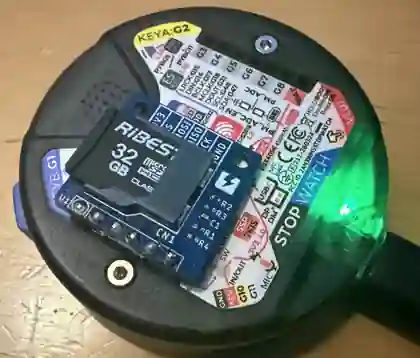

# VinylM5

*English version below / 英語版は下部にあります → [English](#english)*


M5Stack StopWatch用のレコード風MP3プレイヤーです。  
円形ディスプレイに回転するレコードを表示し、MP3を再生します。

**動作風景：** [Xで実機の動作動画を見る](https://x.com/layer812/status/2118882192084607121)

## インストール

M5Burner シェアコード：`F6iadcUkHAM3gnQv`  
WebBurner：[最新版をブラウザから書き込む](https://burner.m5stack.com/LRW3MJ)  
**2026年11月15日：StopWatch実機でmicroSD再生動作を確認済み。**

収録サンプル曲：**Neon Spinback**（Original）

## microSD読み込みサンプル

StopWatch背面のSPI接続例は[サンプルコード](examples/stopwatch-microsd-spi/README.md)で確認できます。VinylM5では**C型（Conta 10770）を公式サポート**します。通常起動ではC型だけを使います。青ボタン（右）を押したまま起動するとB→A型の互換判別へ切り替わり、選択を記憶します。黄色ボタン（左）を押したまま起動すればC型に戻ります。

## 操作方法

| 操作 | 動作 |
| --- | --- |
| 右ボタン（1回） | 再生／一時停止 |
| 右ボタン（ダブルクリック） | 次の曲 |
| 左ボタン（1回） | 次の曲入りフォルダへ移動 |
| 左ボタン（ダブルクリック） | 現在のフォルダ内でランダム選曲 |
| レコード盤を指で押さえて動かす | 停止・正転／逆転スクラッチ |
| 中央ラベルの上側をタップ | 音量アップ |
| 中央ラベルの下側をタップ | 音量ダウン |
| 中央の軸部分を長押し | USBドライブモード |

USBドライブモードでMP3を転送できます。PCでのコピー後は、安全に取り出してから再生に戻してください。

ラベルにはID3の曲名・アーティスト名・ジャケット画像を使用します。埋め込み画像がない場合は、同じフォルダで最初に見つかったPNG画像を使用します。日本語の曲名にも対応しています。

## microSDカードの接続

StopWatch背面の6ピンEXT端子に、**3.3V動作**のmicroSD SPIカードリーダーを接続します。



**電源を切ってから接続してください。** 電源端子の`3V3_L2`と`GND`の位置が一致するカードリーダーのみ使用できます。5Vモジュールや電源配列が異なる基板は直挿ししないでください。

### 公式C型と、起動時に選択できる互換B/A型

いずれも3.3V側からGND側への並びです。

| 種類 | microSDリーダーのピン配列 |
| --- | --- |
| C（標準・公式対応） | `3V3 / SS / MOSI / MISO / SCK / GND` |
| B（青ボタン起動の互換対応） | `3V3 / CS / CLK / MOSI / MISO / GND` |
| A（青ボタン起動の互換対応） | `3V3 / CS / MOSI / CLK / MISO / GND` |

**C配列の製品例：** [スイッチサイエンス Conta microSDカードソケット拡張用モジュール（製品10770）](https://www.switch-science.com/products/10770)

StopWatch側はCS/SS=GPIO43で、GPIO44・GPIO9・GPIO0がMOSI・SCK・MISOに割り当てられます。**通常起動はC型のみ**です。**青ボタン（右／BtnB）を押しながら起動**するとB→Aの互換グループのみを試し、その選択をNVSへ記憶します。以後は何も押さない起動でもB/Aのみ使用します。**黄色ボタン（左／BtnA）を押しながら起動**すると公式C型へ戻り、その選択も記憶します。同時押しでは黄色を優先します。

GPIO0は起動ストラップ端子です。起動時に外部回路からLOWへ固定しないモジュールを使用してください。C型とB/A型ではMISOの場所が異なるため、**C型とB/A型を混在させた自動総当たりは行いません**。B/A内はMISOがGPIO0（INPUT）で共通、CLKとMOSIだけが入れ替わります。一般の未対応モジュールでの電気的な安全性を保証するものではありません。

microSDは**FAT32**を使用します。NTFS・exFATは読み込めません。多数のフォルダがある場合でも、前回選択したフォルダを優先して再生開始し、残りはバックグラウンドで読み込みます。

### ソースからインストール（Windows / PlatformIO）

統合版のソースを取得し、シリアルモニターを閉じてから次のAPP-ONLYスクリプトを実行してください。

```bat
call "RUN_VINYLM5_R16_SD_AUTO_APP_ONLY_COM13.cmd"
```

別のCOMポートを使う場合は末尾に `COM14` などを指定できます。起動APP領域を確認してからアプリケーションのみ書き込み、ブートローダー、パーティション表、音楽データは消去しません。


---

## English

VinylM5 is a vinyl-style MP3 player for the **M5Stack StopWatch**.  
It plays MP3 files while displaying a spinning vinyl record and track label on the round screen.

**Demo video:** [Watch VinylM5 running on real hardware on X](https://x.com/layer812/status/2118882192084607121)

### Installation

**M5Burner share code:** `F6iadcUkHAM3gnQv`  
**WebBurner:** [Install the latest release](https://burner.m5stack.com/LRW3MJ)  
**Verified on a physical StopWatch with microSD playback (November 15, 2026).**

Included sample track: **Neon Spinback** (Original).

### microSD SPI code example

A [standalone SPI reader example](examples/stopwatch-microsd-spi/README.md) documents the StopWatch's rear connector. VinylM5 officially supports Type C (Conta 10770) by default. Hold blue/right at boot to enable and persist B/A compatibility, or yellow/left to restore official C.

### Controls

| Control | Action |
| --- | --- |
| Right button (single click) | Play / pause |
| Right button (double click) | Next track |
| Left button (single click) | Next folder containing playable tracks |
| Left button (double click) | Random track within the current folder |
| Touch and move the record | Hold and scratch forward / backward |
| Tap upper half of center label | Volume up |
| Tap lower half of center label | Volume down |
| Long-press the center spindle | USB drive mode |

Copy MP3 files using USB drive mode, then safely eject the drive on your PC before returning to playback.

The center label displays ID3 track information and embedded cover art. When no embedded artwork is available, the first PNG image found in the same folder is used. Japanese track titles are supported.

### microSD connection

Connect a **3.3V microSD SPI reader** to the StopWatch's rear 6-pin EXT connector while the power is off. Match the physical `3V3_L2` and `GND` positions. Do not directly attach readers with different power pins or a 5V supply.

VinylM5 **officially supports Type C**. B/A readers require a boot-button-selected, persistent compatibility mode (pins from 3.3V to GND):

| Type | Reader pins |
| --- | --- |
| C (official, default) | `3V3 / SS / MOSI / MISO / SCK / GND` |
| B (blue-boot compatibility) | `3V3 / CS / CLK / MOSI / MISO / GND` |
| A (blue-boot compatibility) | `3V3 / CS / MOSI / CLK / MISO / GND` |

The [Switch Science Conta microSD socket module, product 10770](https://www.switch-science.com/products/10770), uses Type C.

Normal boot probes **C only**. Hold **blue/right (BtnB)** at boot to switch to **B then A** probing and save this preference; subsequent boots remain B/A-only. Hold **yellow/left (BtnA)** at boot to restore and persist official C-only mode (yellow wins if both are held). The firmware never probes across C and B/A groups. GPIO0 is a boot-strapping pin and must not be held LOW at reset. Arbitrary third-party reader boards are not guaranteed safe.

Use a **FAT32** microSD card (not NTFS or exFAT). Playback starts from the previous folder while the remaining directory catalog is loaded in the background.

For a source installation, close the serial monitor and run `RUN_VINYLM5_R16_SD_AUTO_APP_ONLY_COM13.cmd` on Windows (append a COM port name when needed). The script verifies the current boot application and writes only the APP partition.


---

## ライセンス / License

ソースコードは **[GPL-3.0-or-later](LICENSE)** で公開しています。外部ライブラリのライセンスは [THIRD_PARTY_LICENSES.md](THIRD_PARTY_LICENSES.md) を参照してください。カバー画像 `vin.gif` はソースコードのライセンス対象外です。

The source code is licensed under **[GPL-3.0-or-later](LICENSE)**. See [third-party notices](THIRD_PARTY_LICENSES.md) for library licenses. Cover artwork `vin.gif` is not covered by the source-code license.
