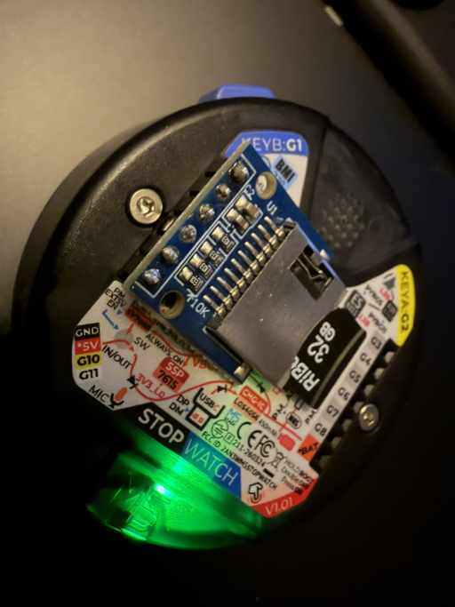

# VinylM5

*English version below / 英語版は下部にあります → [English](#english)*

M5Stack StopWatch用のレコード風MP3プレイヤーです。  
円形ディスプレイに回転するレコードを表示し、MP3を再生します。

**動作風景：** [Xで実機の動作動画を見る](https://x.com/layer812/status/2118882192084607121)

## インストール

M5Burner シェアコード：`OPziEKkRxviwEEDH`  
WebBurner：**更新申請中**（[従来の公開版](https://burner.m5stack.com/PU4PNM)）

収録サンプル曲：**Neon Spinback**（Original）

## 操作方法

| 操作 | 動作 |
| --- | --- |
| 右ボタン（1回） | 再生／一時停止 |
| 右ボタン（ダブルクリック） | 次の曲 |
| 左ボタン（1回） | 次の曲入りフォルダへ移動 |
| 左ボタン（ダブルクリック） | 現在のフォルダ内でランダム選曲 |
| レコード盤を指で押さえて動かす | 停止・正転／逆転スクラッチ |
| 中央ラベルの上側をタップ | 音量アップ |
| 中央ラベルの下側をタップ | 音量ダウン |
| 中央の軸部分を長押し | USBドライブモード |

USBドライブモードでMP3を転送できます。PCでのコピー後は、安全に取り出してから再生に戻してください。

ラベルにはID3の曲名・アーティスト名・ジャケット画像を使用します。埋め込み画像がない場合は、同じフォルダで最初に見つかったPNG画像を使用します。日本語の曲名にも対応しています。

## microSDカードの接続

StopWatch背面の**6ピンEXT端子**に、3.3V動作のmicroSD SPIカードリーダーを接続します。以下は実機で使用している接続例です。

**電源OFFで着脱し、必ず基板のピン印字を確認してください。** StopWatch側の `3V3_L2` とカードリーダーの `3V3`、双方の `GND` が一致する必要があります。写真と外観が似ていても、電源ピンの位置が違うモジュールは直挿ししないでください。5V接続にも対応しません。

VinylM5 R16は、信号線の並びが異なる次の**2種類**を自動的に試行します（3.3V→GND方向）。

| StopWatch側の端子 | GPIO | タイプAのmicroSD印字 | タイプBのmicroSD印字 |
| --- | --- | --- | --- |
| `3V3_L2` | 電源 | `3V3` | `3V3` |
| `MUX_IO_1` | GPIO43 | `CS` | `CS` |
| `MUX_IO_2` | GPIO44 | `MOSI` | `CLK` |
| `G9` | GPIO9 | `CLK` | `MOSI` |
| `G0` | GPIO0 | `MISO` | `MISO` |
| `GND` | GND | `GND` | `GND` |

- **タイプA：** `3V3 / CS / MOSI / CLK / MISO / GND`
- **タイプB：** `3V3 / CS / CLK / MOSI / MISO / GND`

**重要：** GPIO0はBOOT兼用です。microSD側のMISOが起動時にGPIO0をLOWへ固定するモジュールは使用しないでください。電源/GNDの誤配線はソフトウェアで修正できません。

microSDは**FAT32**で使用してください。NTFS・exFATには対応していません。実機では32GB FAT32カードでMP3/FLAC再生を確認しています。曲が多い場合も、R16は前回のフォルダを優先して再生開始し、残りのフォルダをバックグラウンドで読み込みます。microSD内の音楽ファイルを削除・変更・フォーマットすることはありません。

---

## English

VinylM5 is a vinyl-style MP3 player for the **M5Stack StopWatch**.  
It plays MP3 files while displaying a spinning vinyl record and track label on the round screen.

**Demo video:** [Watch VinylM5 running on real hardware on X](https://x.com/layer812/status/2118882192084607121)

### Installation

**M5Burner share code:** `OPziEKkRxviwEEDH`  
**WebBurner:** **Updated release pending review** ([previous published version](https://burner.m5stack.com/PU4PNM))

Included sample track: **Neon Spinback** (Original).

### Controls

| Control | Action |
| --- | --- |
| Right button (single click) | Play / pause |
| Right button (double click) | Next track |
| Left button (single click) | Next folder containing playable tracks |
| Left button (double click) | Random track within the current folder |
| Touch and move the record | Hold and scratch forward / backward |
| Tap upper half of center label | Volume up |
| Tap lower half of center label | Volume down |
| Long-press the center spindle | USB drive mode |

Copy MP3 files using USB drive mode, then safely eject the drive on your PC before returning to playback.

The center label displays ID3 track information and embedded cover art. When no embedded artwork is available, the first PNG image found in the same folder is used. Japanese track titles are supported.

### microSD connection

Attach a **3.3V microSD SPI reader** to the StopWatch's rear **6-pin EXT connector**. The two photos above show an actual module mounted on the watch and the module viewed from the side.

**Power OFF before inserting or removing the reader.** Always verify the printed pin labels: the reader's `3V3` must match StopWatch `3V3_L2`, and `GND` must match `GND`. Do not direct-plug readers with different power-pin positions or 5V wiring.

VinylM5 R16 supports **two specific signal orders**, from 3.3V toward GND:

| StopWatch pin | GPIO | Reader type A | Reader type B |
| --- | --- | --- | --- |
| `3V3_L2` | Power | `3V3` | `3V3` |
| `MUX_IO_1` | GPIO43 | `CS` | `CS` |
| `MUX_IO_2` | GPIO44 | `MOSI` | `CLK` |
| `G9` | GPIO9 | `CLK` | `MOSI` |
| `G0` | GPIO0 | `MISO` | `MISO` |
| `GND` | Ground | `GND` | `GND` |

- **Type A:** `3V3 / CS / MOSI / CLK / MISO / GND`
- **Type B:** `3V3 / CS / CLK / MOSI / MISO / GND`

GPIO0 is a boot-strapping pin; a reader that holds MISO/GPIO0 LOW during boot may prevent startup. Only these two layouts are attempted; arbitrary pin probing is not used.

Use a **FAT32** microSD card (not NTFS or exFAT). MP3/FLAC playback was confirmed on a 32GB FAT32 card. R16 starts from the previous folder while indexing remaining folders in the background. The player does not format or modify files on the card.

---

## ライセンス / License

ソースコードは **[GPL-3.0-or-later](LICENSE)** で公開しています。外部ライブラリのライセンスは [THIRD_PARTY_LICENSES.md](THIRD_PARTY_LICENSES.md) を参照してください。カバー画像 `vin.gif` はソースコードのライセンス対象外です。

The source code is licensed under **[GPL-3.0-or-later](LICENSE)**. See [third-party notices](THIRD_PARTY_LICENSES.md) for library licenses. Cover artwork `vin.gif` is not covered by the source-code license.
