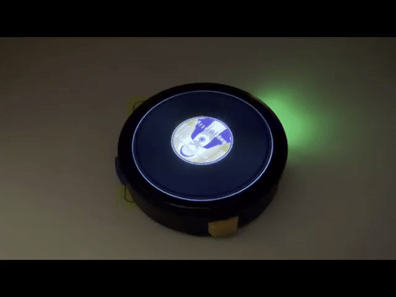

# VinylM5

M5Stack StopWatch用のレコード風MP3プレイヤーです。  
円形ディスプレイに回転するレコードを表示し、MP3を再生します。

## インストール

M5Burner シェアコード：`rg69duyAcUQoohOl`

## 操作方法

| 操作 | 動作 |
| --- | --- |
| 右ボタン（1回） | 再生／一時停止 |
| 右ボタン（ダブルクリック） | 次の曲 |
| 左ボタン | 次のフォルダへ移動（ルートでは最初の子フォルダへ） |
| レコード盤を指で押さえて動かす | 停止・正転／逆転スクラッチ |
| 中央ラベルの上側をタップ | 音量アップ |
| 中央ラベルの下側をタップ | 音量ダウン |
| 中央の軸部分を長押し | USBドライブモード |

USBドライブモードでMP3を転送できます。PCでのコピー後は、安全に取り出してから再生に戻してください。

ラベルにはID3の曲名・アーティスト名・ジャケット画像を使用します。埋め込み画像がない場合は、同じフォルダで最初に見つかったPNG画像を使用します。日本語の曲名にも対応しています。

---

## English

VinylM5 is a vinyl-style MP3 player for the **M5Stack StopWatch**.  
It plays MP3 files while displaying a spinning vinyl record and track label on the round screen.

### Installation

**M5Burner share code:** `rg69duyAcUQoohOl`

### Controls

| Control | Action |
| --- | --- |
| Right button (single click) | Play / pause |
| Right button (double click) | Next track |
| Left button | Next folder (first subfolder from root) |
| Touch and move the record | Hold and scratch forward / backward |
| Tap upper half of center label | Volume up |
| Tap lower half of center label | Volume down |
| Long-press the center spindle | USB drive mode |

Copy MP3 files using USB drive mode, then safely eject the drive on your PC before returning to playback.

The center label displays ID3 track information and embedded cover art. When no embedded artwork is available, the first PNG image found in the same folder is used. Japanese track titles are supported.

---

## ライセンス / License

ソースコードは **[GPL-3.0-or-later](LICENSE)** で公開しています。外部ライブラリのライセンスは [THIRD_PARTY_LICENSES.md](THIRD_PARTY_LICENSES.md) を参照してください。カバー画像 `vin.gif` はソースコードのライセンス対象外です。

The source code is licensed under **[GPL-3.0-or-later](LICENSE)**. See [third-party notices](THIRD_PARTY_LICENSES.md) for library licenses. Cover artwork `vin.gif` is not covered by the source-code license.
